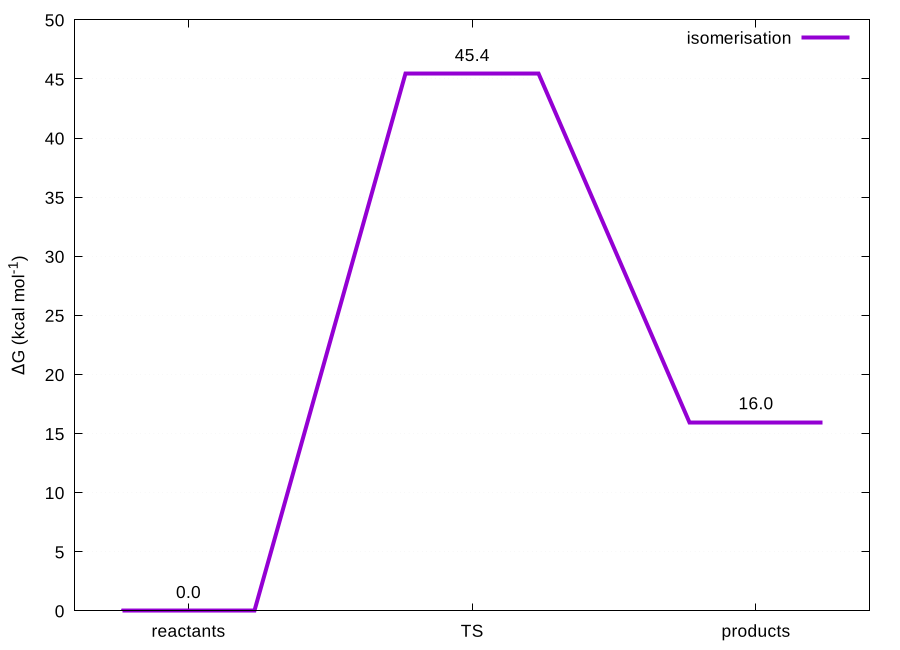

# 06 · Reaction kinetics: barriers, TST rates, Arrhenius fits, POLYRATE

This module turns the thermochemistry tables of modules 01 to 04 into what a reaction mechanism paper reports: activation and reaction energies, enthalpies and free energies, Eyring rate constants with a Wigner tunnelling correction, rates at several temperatures with an Arrhenius fit, and the free energy profile figure. A helper also collects variational TST/SCT rate tables from POLYRATE.

```
06-kinetics/
├── kinetics.sh           barriers.csv, rates.csv, rates-vs-T.csv, arrhenius.csv, profile.dat
├── plot-profile.sh       free energy profile (reactants, TS, products) for every reaction
└── polyrate-extract.sh   final "T(K) Forward Reverse" table of POLYRATE .fu6 files + Arrhenius fit
```

## Input

A plain text file with one reaction per line; `+` joins species:

```
# name           reactants     TS        products
isomerisation    hcn           ts-iso    hnc
h-abstraction    phenol+OH     ts-abs    phenoxyl+H2O
```

Names refer to rows of any `summary.csv` from the extract scripts (Gaussian, ORCA, NWChem or xTB columns are recognised). With `-t thermo.csv` the same reactions are evaluated at every computed temperature.

```bash
06-kinetics/kinetics.sh -r reactions.txt -s nwchem-results/summary.csv -t nwchem-results/thermo.csv -w
06-kinetics/plot-profile.sh -o profile.png
```

## Equations

* Eyring: k = κ (k_B T / h) exp(−ΔG‡/RT), in concentration units (M¹⁻ⁿ s⁻¹ for an n-molecular step).
* Standard state: gas-phase free energies refer to 1 atm. For steps that change the number of species, `-c 1M` (default) adds RT ln(RT/p°) = RT ln 24.46 = 1.89 kcal/mol at 298 K per species, the usual conversion to 1 mol L⁻¹.
* Wigner tunnelling: κ = 1 + (hc|ν‡|/k_BT)²/24, from the imaginary frequency of the TS (`-w`). It is a first-order correction that is reasonable only for modest barriers and frequencies. For hydrogen transfer with a large imaginary frequency, use small-curvature tunnelling (POLYRATE) instead.
* Arrhenius: least-squares fit of ln k against 1/T, giving Ea, A and R².

## Worked example: HCN → HNC (NWChem, B3LYP/6-31G\*, computed here)

`examples/kinetics-hcn-hnc/` contains the inputs and the CSV results of real NWChem runs:

| quantity | value |
|---|---|
| ΔE‡ / ΔH‡ / ΔG‡ (298 K) | 50.1 / 46.7 / 45.4 kcal/mol |
| ΔE / ΔG of reaction | 16.6 / 16.0 kcal/mol |
| imaginary frequency of the TS | −1147 cm⁻¹ (Wigner κ = 2.28 at 298 K) |
| Arrhenius fit 250–400 K | Ea = 194.6 kJ/mol, R² = 1.000 |



## Corrections made to the original scripts

* **Fewer, more general scripts.** The old kinetics scripts were written per program (`analyse-kinetics-orca`) and per reaction set. The new script reads any extract table, so the same analysis works for Gaussian, ORCA, NWChem and xTB.
* **Standard state.** The 1 atm → 1 M correction for bimolecular steps was not applied before. It is now explicit and switchable with `-c`.
* **Tunnelling and temperature range.** Wigner tunnelling and the multi-temperature Arrhenius fit are new.
* **POLYRATE input preparation is not included.** The old scripts depended on site-specific GAUSSRATE templates. The extractor reads the same rate table the old `extract-polyrate` read, but no POLYRATE output was available to test it.

## Tested

`tests/test-06-kinetics.sh` (9 checks) recomputes the HCN → HNC numbers from the stored NWChem tables and checks the Eyring rate against a hand calculation, the Wigner factor, the kJ/kcal conversion, the multi-temperature table, the Arrhenius fit and the plot.
