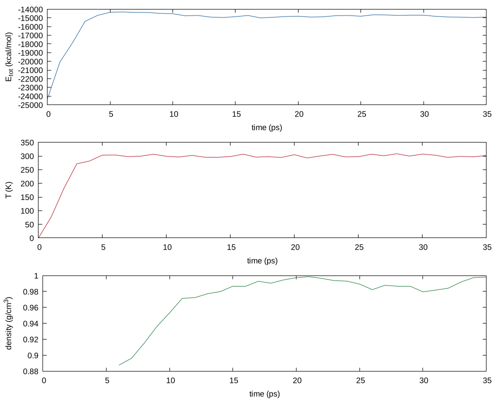

# 08 · Amber: parameters, MD and binding free energies

The full path from a ligand structure and a protein PDB to a solvated system, a standard equilibration and production protocol, trajectory analysis and MM-GBSA binding energies with per-residue decomposition.

```
08-amber/
├── prepare/
│   ├── amber-ligand-params.sh  GAFF2 + AM1-BCC parameters (antechamber, parmchk2)
│   └── amber-build.sh          tleap: ff14SB + GAFF2 + water + ions, dry topologies for MM-PBSA
├── run/
│   ├── amber-md-inputs.sh      min1, min2, heat, density, equil, prod + a restartable job script
│   └── amber-amd-inputs.sh     accelerated MD parameters computed from a finished cMD run
└── analysis/
    ├── amber-analysis.sh       one cpptraj pass: RMSD, RMSF, Rg, H-bonds, contacts, clusters, DSSP
    ├── amber-mmpbsa.sh         MM-GBSA/PBSA with decomposition and a top-residues table
    └── plot-md.sh              PNG plots of every time series (shared with module 09)
```

## Workflow

```bash
08-amber/prepare/amber-ligand-params.sh -m bcc ligand.sdf          # -> amber-ligands/ligand/LIG.mol2 + LIG.frcmod
08-amber/prepare/amber-build.sh -n complex -p receptor.pdb -L amber-ligands/ligand -b 10 -s 0.15
08-amber/run/amber-md-inputs.sh -d amber-systems/complex -T 300 -H 200 -D 200 -E 2000 -P 100 -g
bin/qdm-submit -s run-md.sh amber-systems/complex
08-amber/analysis/amber-analysis.sh -d amber-systems/complex -y prod.nc
08-amber/analysis/amber-mmpbsa.sh   -d amber-systems/complex -f 1:last:10
```


The complete sequence, a docked pose through the full MD protocol to MM-GBSA, is in [`../docs/running.md`](../docs/running.md#c-protein-ligand-md-in-amber). Every script also prints its own usage block with `-h`.

## What the build does

* `pdb4amber` cleans the receptor (hydrogens removed and rebuilt by tleap, waters dropped unless `-X`, disulfides and chain breaks reported).
* tleap loads **ff14SB** for the protein, **GAFF2** for every ligand, TIP3P (or OPC, SPC/E) water and Joung-Cheatham ions, sets `PBRadii mbondi2` for GB, builds a truncated octahedron with the requested buffer, neutralises, and then adds salt at the requested molarity computed from the actual number of waters (55.5 mol/L).
* It writes `solv.prmtop/.inpcrd` **and** the dry `complex`, `receptor` and `ligand` topologies in the same run, so MM-PBSA never needs `ante-MMPBSA.py` and can never pick up a mismatched topology.
* tleap errors stop the script; warnings are counted and the log is named.

## The protocol

| stage | ensemble | restraints | default length |
|---|---|---|---|
| min1 | minimisation | solute 10 kcal/mol/Ų | 5000 steps |
| min2 | minimisation | none | 5000 steps |
| heat | NVT, 0 → T with `nmropt` ramp | solute 5 | 100 ps |
| density | NPT, Monte Carlo barostat | solute 2 | 100 ps |
| equil | NPT | none | 1 ns |
| prod | NPT | none | 10 ns (`-P`) |

Langevin thermostat (γ = 2 ps⁻¹), SHAKE on bonds to hydrogen, 2 fs steps, PME with a 10 Å cutoff. `run-md.sh` skips any stage whose restart file already exists, so a job that hits the wall clock continues where it stopped.

## Binding free energies

`amber-mmpbsa.sh` runs MM-GBSA (igb = 5, 0.15 M salt) and optionally PB, with per-residue decomposition (`idecomp=2`). The residues to decompose default to everything within 6 Å of the ligand, found from `complex-dry.pdb`, instead of a hand-typed list. Outputs are `summary.csv` (every energy term with its standard deviation) and `top-residues.csv`. Entropy is not computed: these numbers are for ranking a ligand series, not for absolute affinities.

## Corrections made to the original scripts

* **Cluster paths and project codes**, including collaborators' scratch directories, were written into every script; they are now in `config/cluster.conf` and nothing personal is left in the repository.
* **Ligand net charge** was typed in by hand. It now comes from `chargemult.txt` or from the formal charges in the structure, and the sum of the fitted partial charges is reported so a mismatch is obvious.
* **Guessed parameters.** `parmchk2` lines marked `ATTN, need revision` are printed, because those are the force constants that were not in GAFF2 and may need refitting.
* **Salt concentration.** The original builds only neutralised the system; the new one adds salt at a stated molarity computed from the water count.
* **Barostat.** Berendsen (`ntp=1, taup=2.0`) does not give the correct NPT ensemble; the Monte Carlo barostat (`barostat=2`) is used instead.
* **Heating.** The original heated by setting `tempi=0, temp0=300` in one step, which is a temperature jump rather than a ramp; `nmropt` now ramps the target temperature over the first half of the heating stage.
* **Restarts.** The old job scripts ran every stage unconditionally, so a resubmission started again from minimisation.
* **Analysis.** Eight or more separate ptraj scripts became one cpptraj pass over the trajectory.
* **aMD parameters** were computed by hand with a chain of grep and awk commands recorded in comments; `amber-amd-inputs.sh` reads the cMD output and applies the published rules itself.
* **PyReweighting** (Miao et al.) for aMD reweighting is cited, not redistributed. [`../docs/third-party-material.md`](../docs/third-party-material.md#pyreweighting) says where to get it and how it joins this workflow, and [`../docs/running.md`](../docs/running.md#f-accelerated-md-and-reweighting) gives the full aMD sequence.
* The secondary structure output is named `dssp.dat` and `dssp-summary.dat`, but it comes from `cpptraj`'s built-in `secstruct` command. No external DSSP program is needed.

## Tested

A full build was run here on a real system: **Abl kinase with imatinib (PDB 1IEP)**, 43,914 atoms, 13,190 waters, 36 Na⁺/Cl⁻ pairs, solute charge −8, no tleap errors.

A smaller imatinib-in-water box (5,363 atoms) was then run through the **whole protocol** with `sander`, and analysed with `amber-analysis.sh`. The run behaves as it should: the temperature ramps from 0 to 300 K and holds, the total energy settles, and the density converges to about 1.0 g/cm³, the right value for water. Inputs, the energy table and this figure are in `examples/amber-imatinib-water/`.



`tests/test-08-amber.sh` reproduces the ligand parameterisation, the build and the input generation. MM-PBSA needs a longer production trajectory and a protein-ligand complex, so it was not run here.
