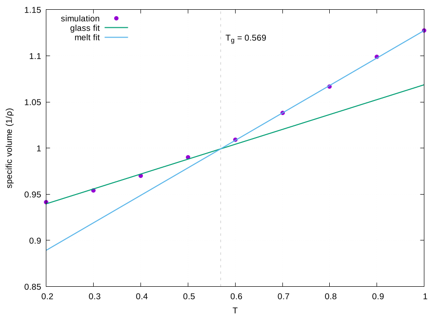

# 11 · LAMMPS: polymer and materials properties

Glass transition temperature, elastic modulus, viscosity, structure and diffusion for polymers and other soft materials. One system definition drives all of them.

```
11-lammps/
├── prepare/
│   ├── build-bead-spring.sh  coarse-grained polymer melt for testing the whole chain
│   └── lammps-inputs.sh      params.in + the five runs + a job script
├── templates/
│   ├── equilibrate.in        minimise, NVT heat, NPT density
│   ├── glass-transition.in   stepwise NPT cooling, density at every temperature
│   ├── elastic.in            uniaxial deformation at constant strain rate
│   ├── viscosity.in          Green-Kubo shear viscosity
│   └── rdf-msd.in            radial distribution function and mean squared displacement
└── analysis/
    ├── lammps-tg.sh          Tg from the bilinear fit of specific volume against T
    ├── lammps-elastic.sh     Young's modulus and yield point from the stress-strain curve
    └── lammps-viscosity.sh   plateau of the running Green-Kubo integral
```

## Workflow

```bash
# an atomistic system converted from Amber (ParmEd/InterMol) or a test melt:
11-lammps/prepare/build-bead-spring.sh -c 50 -n 20 -r 0.85 -o poly
11-lammps/prepare/lammps-inputs.sh -s poly/system.in -D poly/system.data -u lj \
    -T 1.0 -P 0.0 -H 1.0 -L 0.2 -n 9 -o run
cd run && bash run.sh                      # or: bin/qdm-submit run

11-lammps/analysis/lammps-tg.sh -i tg-density.dat
11-lammps/analysis/lammps-elastic.sh -i stress-strain.dat -m 0.03
11-lammps/analysis/lammps-viscosity.sh -i viscosity-running.dat
```

`system.in` holds the units, styles, `read_data ${data}` and every force field coefficient, once. `params.in`, written by `lammps-inputs.sh`, holds the temperature, pressure, timestep, damping, run lengths and the unit conversion factors. Every template includes both, so changing the system or the temperature never means editing five input files.

## Results from the test melt

A bead-spring melt (50 chains of 20 beads, ρ\* = 0.85, LJ units) was built and run here end to end; the files are in `examples/lammps-bead-spring/`.

| property | value | how |
|---|---|---|
| glass transition | T\*g = 0.569 | bilinear fit of 1/ρ against T over 9 temperatures, α_glass = 0.161, α_melt = 0.298 |
| Young's modulus at T\* = 0.3 | E\* ≈ 7 | slope below 3 % strain of the smoothed stress-strain curve |
| shear viscosity at T\* = 1.0 | η\* = 3.2 ± 0.6 | plateau of the running Green-Kubo integral |



These are reduced units for a generic melt, so they are not meant to match any real polymer; they show that the chain from building to property extraction works. The stress-strain curve of a 1000-bead box at a high strain rate is very noisy, which is why the modulus is fitted to a running mean and why the raw curve is drawn next to it. A publishable modulus needs a much larger box, slower deformation and several independent runs.

## Corrections made to the original scripts

* **Force field coefficients were repeated** in every one of the seven input files, and a separate `reformat-lammps-input-*` script regenerated each file with `sed` for each new system. They are now in one included file.
* **`write_data` without `nocoeff`** wrote pair coefficients into the data file, so the next run failed with `Must define pair_style before Pair Coeffs`. This was the first error hit when re-running the old templates, and it is fixed in the template.
* **Fixed averaging window.** The old viscosity and conductivity extraction averaged after a fixed number of steps. The plateau is now averaged over the last half of the run, with the standard deviation reported and the running integral plotted so the plateau can be seen.
* **Tg fit.** The split between the glassy and rubbery branches was chosen by hand. Every split with at least three points per branch is now tried and the best one kept; the thermal expansion coefficient of each branch is reported as well.
* **Yield point.** Reported from a smoothed curve, with the smoothing window exposed as an option, rather than from the first noisy maximum.

## Tested

`tests/test-11-lammps.sh` builds a small melt, equilibrates it, runs a short cooling ramp, and checks the analysis scripts against the stored example data (Tg, modulus and viscosity).
