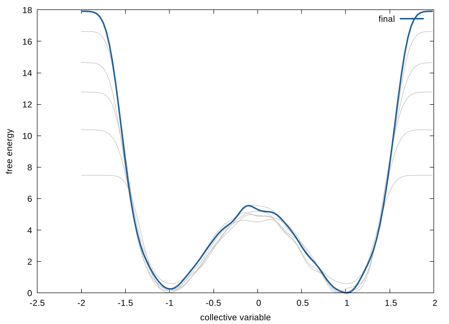

# 12 · PLUMED: metadynamics and funnel metadynamics

Enhanced sampling on top of the MD engines of modules 08, 09 and 10. The main use here is the absolute binding free energy of a ligand by **funnel metadynamics**, where a funnel-shaped restraint keeps the unbound ligand in a defined volume so that the binding free energy can be computed without sampling the whole solvent box.

```
12-plumed-metadynamics/
├── plumed-input.sh   well-tempered metadynamics, with or without a funnel restraint
└── plumed-fes.sh     free energy profile, convergence check, funnel binding free energy
```

## Workflow

```bash
# collective variable: the ligand along the axis from a buried pocket point A
# towards the solvent point B; the funnel is a cone below zcc and a cylinder above
12-plumed-metadynamics/plumed-input.sh -p complex.pdb -l LIG \
    -a "315,381" -b "40,44" -z 1.8 -r 0.1 -m -0.2 -M 3.0 \
    -s 0.05 -H 1.2 -g 10 -T 300 -P 500 > plumed.dat

# Amber:   plumed=1, plumedfile='plumed.dat' in &cntrl
# GROMACS: gmx mdrun -plumed plumed.dat   (PLUMED-patched build)
# CP2K:    10-cp2k/cp2k-input.sh -P

12-plumed-metadynamics/plumed-fes.sh -i HILLS -k 2.494339 -n 6 -u 0.5:2.5 -r 0.1
```

The funnel is built from standard PLUMED actions (`PROJECTION_ON_AXIS`, `CUSTOM`, `UPPER_WALLS`), so the optional funnel module does not have to be compiled into PLUMED. The method is Limongelli, Bonomi and Parrinello, *PNAS* **2013**, 110, 6358.


The complete sequence, funnel metadynamics from an equilibrated system to an absolute binding free energy, including what to watch while it runs, is in [`../docs/running.md`](../docs/running.md#e-funnel-metadynamics-absolute-binding-free-energy). Every script also prints its own usage block with `-h`.

## Binding free energy

With `-u SITE_MAX:UNBOUND_MIN`, `plumed-fes.sh` computes

* K_b = π R_cyl² ∫_site exp(−[W(z) − W_unbound]/kT) dz
* ΔG_b = −kT ln(C° K_b), with C° = 1/1660 Å⁻³ (1 mol/L)

W_unbound is averaged over the plateau beyond `UNBOUND_MIN`, which is also the region whose flatness tells you whether the simulation has converged.

## Convergence

`plumed-fes.sh` reconstructs the profile from increasing fractions of the hills and plots them together with the final one. Profiles that still shift between the last two fractions mean the run is not converged, which is the main failure mode of metadynamics and the reason this plot is produced automatically rather than on request.

## Tested, with a result whose answer is known

A two-dimensional double-well potential V(x,y) = 5(x²−1)² + 2y² was sampled with well-tempered metadynamics through `plumed pesmd` (400,000 steps, 2,000 hills, bias factor 10, kT = 1). The analytic barrier between the two minima at x = ±1 is exactly 5 energy units, and the recovered profile gives **5.27**, with both minima at the right positions and the expected symmetry:



The grey curves are the intermediate profiles; they converge onto the final one away from the walls, which is what a converged run looks like. The input files are in `examples/metad-double-well/`.

The funnel input generator is tested on a real protein-ligand PDB (atom selections, geometry of the restraint and the PLUMED syntax), but a funnel metadynamics run itself needs hundreds of nanoseconds and was not run here.

## Corrections made to the original scripts

* The funnel parameters were set in a TCL script and a set of shell scripts specific to one system, and depended on the optional `funnel` module being compiled in. The restraint is now generated from standard actions for any system from residue selections.
* The third-party funnel visualisation and analysis scripts that sat in the original folder are not redistributed. The reference input for PLUMED's funnel module is on PLUMED-NEST at [eggs/19/039](https://www.plumed-nest.org/eggs/19/039/); see [`../docs/third-party-material.md`](../docs/third-party-material.md#funnel-metadynamics-tutorial-files).
* `plumed sum_hills` was run with a fixed temperature factor; kT is now a parameter, and the convergence series is produced in the same call.
